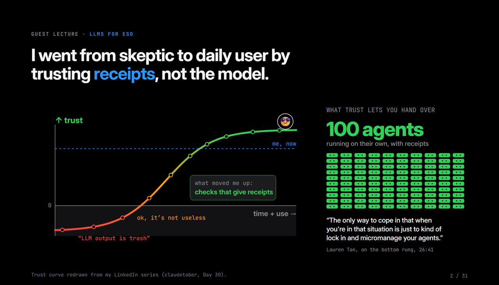
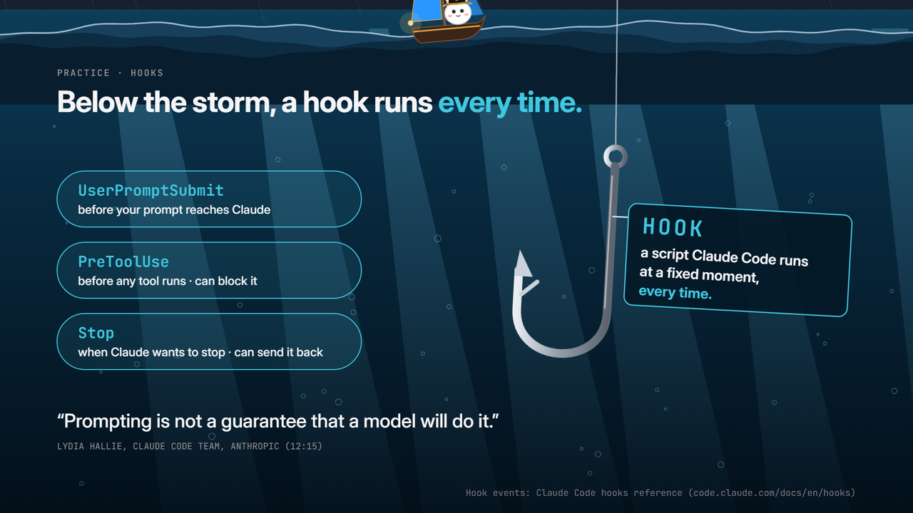

# LLMs for ESD

Talks on large language models and coding agents that I gave at the Singapore University of Technology and Design. Each deck is one self-contained HTML file built with D3. Every slide, animation and speaker note is in that lecture's `src/`.

### ▶ [Open the talks in your browser](https://darrylteo.github.io/llms-for-esd-talk/)

## Lecture 1: LLMs for ESD

**[Open lecture 1](https://darrylteo.github.io/llms-for-esd-talk/lecture-1/talk.html)** · 30 minutes · engineering students · Fall 2026 · [lecture-1/](lecture-1/)

How coding agents are built (the harness), what goes into their context, and how to evaluate their output, with examples from my own research. 1 min hook, 22 min technical (harness, context, evals), 7 min applications. How to present it: [lecture-1/README.md](lecture-1/README.md).

## Lecture 2: The Age of LLMs

**[Open lecture 2](https://darrylteo.github.io/llms-for-esd-talk/lecture-2/talk.html)** · 15 minutes · faculty and staff · November 2026 · [lecture-2/](lecture-2/)

A shorter talk for faculty and staff, built from lecture 1's slides. It covers how teaching machine learning changed between 2019 and now, with a live demo of [ML Explainers](https://ml-explainers.sutdpm.workers.dev), how agents work, and three habits: checks, hooks, and keeping personal data (PDPA) out of the prompt. The hook from the PDPA slide, with its tests, is in [lecture-2/handout/](lecture-2/handout/). How to present it: [lecture-2/README.md](lecture-2/README.md).

## Presenting

Open a lecture's `talk.html` in Chrome or Edge. It works offline; keep that lecture's `clips/` and `film/` folders next to it.

| Key | Action |
|---|---|
| → / Space / PageDown, ← | Next and previous build (a clicker works too) |
| F | Fullscreen |
| P | Presenter view in a second window: notes, next build, clock and plan timer (**T** resets it) |
| N | Notes strip in the main window, if the pop-up is blocked |
| B | Blank the screen |
| number + Enter | Jump to a slide |
| G, or the mouse at the bottom edge | Slide picker (**Esc** hides it) |

## Repository layout

| Path | What it is |
|---|---|
| `index.html` | The landing page above, served by GitHub Pages |
| `lecture-1/`, `lecture-2/` | One folder per talk: `talk.html` (built deck), `src/` (slides, notes, animation, engine), `data/`, `clips/`, `film/`, `assets/`, and `scripts/eval_deck.py` (that talk's checks) |
| `shared/build.py` | Assembles a lecture's `src/` into `talk.html` (offline, fonts and D3 inlined) and `artifact/index.html` (CDN version) |
| `shared/shoot.py` | Renders every slide in headless Chrome and records script errors and overflow |
| `shared/theme-keynote.css` | Colours and fonts used by both decks |
| `shared/vendor/` | D3 7.9.0 and the Inter and JetBrains Mono fonts |
| `talk.html` | Redirect, so links to lecture 1's earlier address still open it |

## Not included

The talk transcripts and notes behind the quotes (`src/data/sources/`) and lecture 1's provenance file for its numbers (`src/data/claims.json`) stay off GitHub. Every quote and number on the slides was checked against them before each talk. Notes for coding agents (building, checking, re-rendering the films) are in [AGENTS.md](AGENTS.md).
