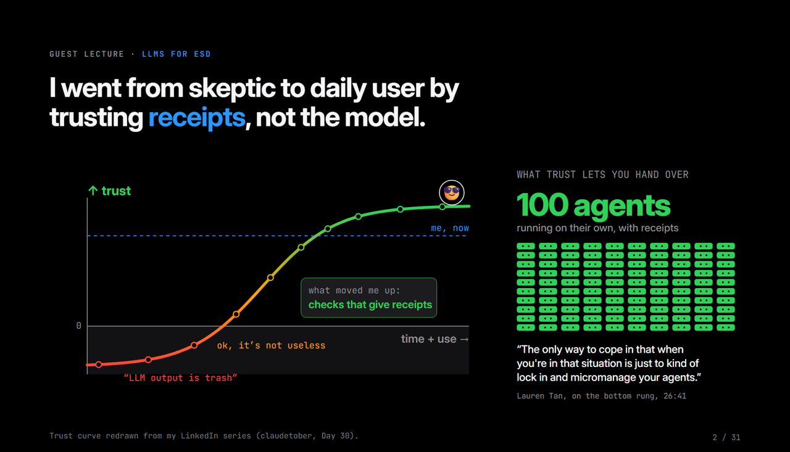

# Lecture 1: LLMs for ESD

### ▶ [Open the talk in your browser](https://darrylteo.github.io/llms-for-esd-talk/lecture-1/talk.html)

Press → or Space to advance, F for fullscreen and P for the presenter view.

30-minute talk: 1 min hook, 22 min technical (harness, context, evals), 7 min applications.

Part of a series: [lecture 2, The Age of LLMs](../lecture-2/), is a 15-minute version for faculty and staff. The [repository README](../README.md) lists both.

I gave this lecture to engineering students at the Singapore University of Technology and Design in Fall 2026. It covers how coding agents are built (the harness), what goes into their context, and how to evaluate their output, with examples from my own research. The deck is one self-contained HTML file built with D3; every slide and animation is in `src/`.

Short clips are screen recordings shown with attribution on their slides. The talk transcripts and notes behind some quotes (`src/data/sources/`) and the provenance file for each number (`src/data/claims.json`) are not included in this repository, so `src/scripts/eval_deck.py` only runs on the original copy.

## Presenting (laptop over HDMI)

1. Open `talk.html` in Chrome or Edge. It is self-contained and works offline (fonts and D3 are embedded).
2. Press **F** for fullscreen on the projector.
3. Press **P** to open the presenter view in a second window: current and next build, speaker notes, a clock, and a plan timer (green while you are on time). Drag that window to the laptop screen. **T** resets the timer.
   If the browser blocks the pop-up, press **N** for a notes strip at the bottom of the main window instead.
4. Use → / Space / PageDown, or a clicker, to advance. ← to go back. Type a number and Enter to jump to that slide. **B** blanks the screen.
5. During questions, move the mouse to the bottom edge (or press **G**) for a row of numbered slide buttons. Hover one to see its headline; click it to jump there, fully built. **Esc** hides it.

Slide 1 starts black. Your first click starts the 25-second opening film (with sound, so check the laptop volume); a second click skips to its last line.

The last slide starts black too. One click plays the WALL-E clip (silent, 17 s); when it ends, the screen turns into the questions slide by itself with a short swell of music. Click again to skip the clip.

Engagement moments are marked ★ in the notes: show of hands (slide 2), pages guess (6), guess the bill (17), the debate vote (19), spot the bad eval (21).

## Copying it to the laptop

Copy `talk.html` with its `film/` and `clips/` folders beside it. Without `film/opening.mp4`, slide 1 plays a silent animation of the same opening instead.
