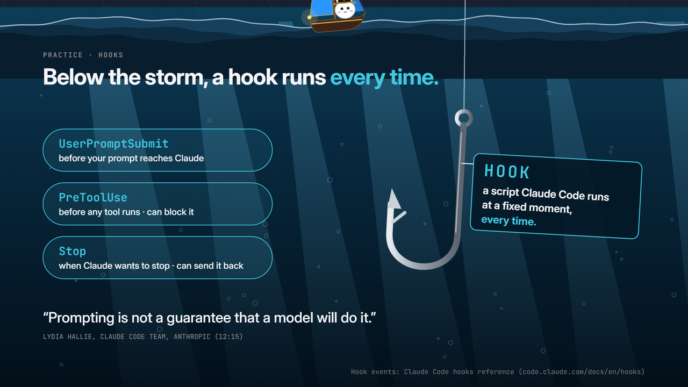

# Lecture 2: The Age of LLMs

### ▶ [Open the talk in your browser](https://darrylteo.github.io/llms-for-esd-talk/lecture-2/talk.html)

Press → or Space to advance, F for fullscreen and P for the presenter view.

A 15-minute talk for SUTD faculty and staff, built from the slides of [lecture 1](../lecture-1/). There is no Q&A slot. It covers how teaching machine learning changed between 2019 and now, with a live demo of [ML Explainers](https://ml-explainers.sutdpm.workers.dev), how agents work, and three habits: checks, hooks and keeping personal data (PDPA) out of the prompt. The hook from the PDPA slide is in `handout/`, with its tests.

| Section | Time | Slides |
|---|---|---|
| Opening, then teaching in 2019 vs now | 8:00 (includes a 4:00 live demo) | 1–4 |
| How LLMs work | 2:00 | 5–6 |
| Best practices: checks, hooks, PDPA | 5:00 | 7–11 |

## Presenting (laptop over HDMI)

1. Open `talk.html` in Chrome or Edge. It works offline. Keep `clips/` and `film/` next to it.
2. **F** fullscreen, **P** presenter view (notes, next build, timer), **N** notes strip, **B** blank, number + Enter to jump, **G** or the bottom edge for the slide picker.
3. **Slide 1** starts black. Click 1: a bound book of the 29 slides; each page peels up from its bottom-right corner and turns, faster and faster, with a soft paper sound. Click 2: the recorded forest. Click 3: the line and your name.
4. **Slide 3**, click 3 shows the demo card. Switch to the browser tab at https://ml-explainers.sutdpm.workers.dev for about 4 minutes (demo steps are in the notes), then come back.
5. **Slide 8** plays rain and one thunder clap as it opens, so check the laptop volume. Click 1 pulls the view underwater and the sound fades out.
6. **Slide 11**: one click plays WALL-E (silent, 17 s). It then turns into the thank-you screen with a short swell. Click again to skip.

## Files

| Path | What it is |
|---|---|
| `talk.html` | The deck to present (built, offline) |
| `artifact/index.html` | The same deck for a claude.ai Artifact link (CDN fonts and D3) |
| `src/slides.html`, `src/slides.js` | Every slide, its speaker notes, and its animation, keyed by slide id |
| `src/engine.js`, `src/deck.css`, `src/shell.html` | Slide engine and styles, from lecture 1. Colours and fonts are in `../shared/theme-keynote.css` |
| `assets/` | Kaggle crop (classmates' photos blurred), explainer screenshot, QR code |
| `clips/rf-forest.mp4` | 25 s recording of the live Random Forest explainer: one split chosen by hand, the forest growing, a new student dropped through it (`src/scripts/record_explainer.js`) |
| `handout/` | `block_pii.py` (UserPromptSubmit hook), its planted test, and a one-page handout |

## Checks

Before the talk, `src/scripts/eval_deck.py` checked timing, headline length, rendering and overflow on every slide, every quote and key number against its source, the files the deck references, the hook's tests, and writing style. The sources (transcript excerpts and build logs) aren't published, so the quote and number checks only run on the original copy.

Slide 1's flip-book is a pre-rendered film (`film/flipbook.mp4`, 60 fps with the paper sounds baked in): each page is a WebGL mesh that peels up from its bottom-right corner and bends like paper. If the file is missing, a simpler CSS version plays instead.
